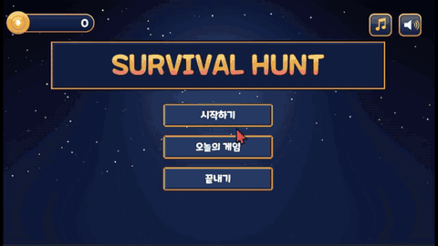
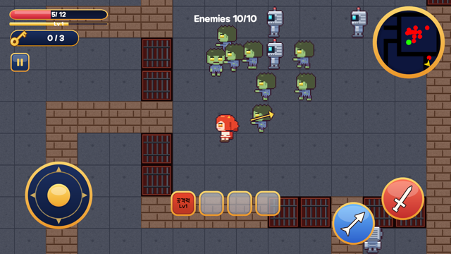
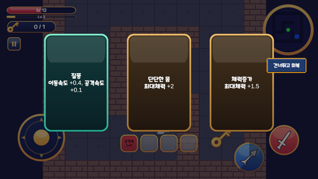
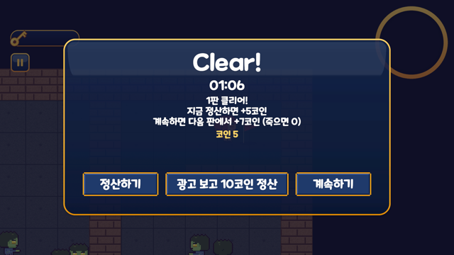

# 🎮 Unity 게임 포트폴리오

> 혼자 기획하고 코드까지 직접 구현한 Unity 게임 프로젝트 모음입니다.
> 코드는 전부 직접 작성했고, 아트·UI는 외부 에셋을 사용했습니다.

   

  

## 👋 한눈에 보기

- 📱 **기획부터 출시 준비까지 혼자 한 모바일 게임 1개** (Survival Hunt, Google Play 비공개 테스트 중)
- 🎮 **방치형, 액션 플랫포머, 육성 시뮬레이션 프로토타입 3개**
- 🧩 모든 프로젝트의 **코드는 직접 작성**했고, 구조와 겪은 문제를 각 저장소 README에 정리했습니다.

---

## ⭐ 대표작: Survival Hunt

> 미로 속 몬스터를 사냥하고, 카드를 골라 성장하며, 출구까지 살아남는 2D 서바이벌 액션 모바일 게임

| | |
|---|---|
| 장르 | 2D 서바이벌 액션 / 로그라이트 |
| 엔진 | Unity 6000.3.8f1 (2D URP, C#) |
| 플랫폼 | Android (가로 화면) |
| 개발 | 1인 개발: 기획, 프로그래밍, UI, 캐릭터 애니메이션, 스토어 출시 준비 |
| 상태 | **Google Play 비공개 테스트 진행 중** (출시 준비) |

| 전투 | 카드 선택 | 클리어 / 정산 |
|:---:|:---:|:---:|
|  |  |  |

**핵심 구현**

- **데이터 주도 설계**: 캐릭터와 카드를 ScriptableObject로 정의해, 새 카드나 캐릭터를 코드 수정 없이 추가
- **카드 성장과 속성 시너지**: 슬롯에 담긴 카드의 효과를 한 곳에서 합산하고 같은 속성 개수에 따라 시너지 적용
- **절차적 미로 생성**: 판마다 새로 생성하고, 날짜 기반 시드로 "오늘의 게임"은 모두에게 같은 미로를 제공
- **난이도 곡선**: 단계별 체력, 이동 속도, 스폰 간격 배율을 한 곳에서 계산
- **오브젝트 풀링**: 적을 재사용하고, 풀 생성 시점에 난이도 배율을 한 번만 적용해 재사용 시 배율 누적을 방지
- **판 사이 상태 이어받기**: 씬을 다시 로드해도 체력, 카드, 레벨 유지
- **보상 경제와 광고**: 클리어 보상 구조, 정산 또는 계속하기 선택, 보상형 광고 연동(Unity LevelPlay)
- **출시 준비**: Play Console 비공개 테스트, 개인정보처리방침, 광고 선언, 데이터 보안 양식

## 🗂️ 다른 프로젝트

| 게임 | 장르 | 핵심 구현 | 저장소 |
|---|---|---|---|
| **Dream 꿈속의조작법** | 2D 액션 플랫포머 (리메이크 준비 중) | 플레이어 조작(코요테 타임·대시), 전투(히트박스·넉백), 대화 분기, 적 AI, 구역별 카메라, 저장/불러오기. 적 AI와 물리 충돌 
| **Monster Idle** | 모바일 방치형 (Android 빌드 완료) | 터치 입력과 피드백, 업그레이드 데이터(ScriptableObject), 오브젝트 풀링, JSON 저장, 오프라인 보상, 효과음, 실기기 테스트 | 
| **PrincessMakerLike** | 육성 시뮬레이션 (프로토타입) | 활동 선택 → 능력치 변화, 조건 이벤트·엔딩, ScriptableObject 데이터 설계, 저장/불러오기 | 

## 📝 개발 블로그

개발하며 막힌 문제와 해결 과정을 정리합니다. → [jaysdaily.tistory.com](https://jaysdaily.tistory.com/)

- 경사면에서 캐릭터가 미끄러지는 문제를 브레이크 콜라이더로 해결
- Dictionary가 JSON으로 직렬화되지 않는 문제 발견과 해결
- 비활성 컴포넌트에서 `OnMouseDown`이 호출된 원인
- 몬스터가 방향을 바꿀 때 체력바가 같이 뒤집히는 문제
- 조건부 대화 시스템(GameFlags, 스킵, 씬 트리거)

## 🔧 게임에서 다룬 것

| 주제 | Survival Hunt | Monster Idle | Dream 꿈속의조작법 | PrincessMakerLike |
|---|---|---|---|---|
| 조작·입력 | 가상 조이스틱, 공격 버튼 | 터치 입력, 터치 피드백 | 이동, 점프, 대시, 경사면 | - |
| 전투·AI | 자동 조준, 몬스터 추적 | - | 히트박스, 넉백, 적 AI | - |
| 데이터 설계 | ScriptableObject 캐릭터·카드 | ScriptableObject 업그레이드 | 스토리 진행 플래그 | ScriptableObject 활동·이벤트·엔딩 |
| 절차적 생성 | 시드 기반 미로 | - | - | - |
| 성능 | 오브젝트 풀링 | 오브젝트 풀링 | - | - |
| 상태 관리 | 판 사이 세션 이어받기, 코인 이벤트 | 골드·레벨·수입 계산 | 체력, HUD 연동 | 능력치 변경 알림 → UI 갱신 |
| 저장/불러오기 | PlayerPrefs | JSON 저장, 오프라인 보상(최대 8시간) | 저장/불러오기 | JSON 저장, Dictionary는 DTO로 처리 |
| 카메라·씬 | 씬 전환 시 상태 유지 | - | Cinemachine, 씬 전환 | - |
| 빌드·배포 | Android, Google Play 비공개 테스트, 광고 연동 | Android 빌드, 실기기 확인 | - | - |

---

## 🧰 다른 포트폴리오

센서·통신·AI 연동 중심의 인터랙티브 콘텐츠는 별도 저장소에 있습니다.
→ [unity-interactive-portfolio](https://github.com/jay-7314/unity-interactive-portfolio)

## 🙋 About

- **이름**: 하정우
- **이메일**: hjh268100@gmail.com
- **경력**: Unity 개발 1년 3개월 (인터랙티브 콘텐츠 17건)
